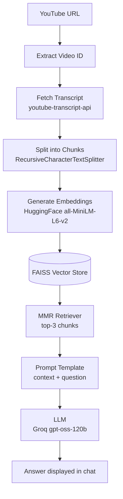

# 🎥 YouTube RAG Assistant
 
A Retrieval-Augmented Generation (RAG) chatbot that lets you have a conversation with any YouTube video. Paste a video URL, and the app fetches its transcript, indexes it, and answers your questions using only the content spoken in the video.
 
Built with Streamlit, LangChain, FAISS and Groq. Tested with real users and evaluated with RAGAS (see [User Testing](#-user-testing) and [Evaluation](#-evaluation)).
 
---
 
## ✨ Features
 
| 📝 **Transcript Extraction** | 🧩 **Smart Chunking** |
|---|---|
| Automatically fetches English captions from any YouTube video using its video ID. | Splits long transcripts into overlapping chunks so context isn't lost at boundaries. |
 
| 🔍 **Semantic Retrieval** | 💬 **Grounded Q&A Chat** |
|---|---|
| Uses vector embeddings + MMR search to find the most relevant *and* diverse transcript chunks. | Answers are generated strictly from retrieved context — not the model's general knowledge. |
 
| ⚡ **Cached Processing** | 🖥️ **Simple Chat UI** |
|---|---|
| Videos are indexed once and cached, so re-asking questions doesn't re-process the transcript. | Persistent, familiar chat interface built entirely with Streamlit. |
 
---
 
## 🏗️ System Architecture
 

 
---
 
## 🧠 How It Works
 
### 🔗 Step 1 — URL Parsing
The video ID is extracted from either a standard (`youtube.com/watch?v=`) or shortened (`youtu.be/`) YouTube URL.
 
### 📝 Step 2 — Transcript Fetching
The transcript is retrieved via the YouTube Transcript API and joined into a single block of raw text. If a video has no captions, the app shows an error message in the sidebar.
 
### 🧩 Step 3 — Chunking
The transcript is split into ~1000-character chunks with 200-character overlap:
```python
RecursiveCharacterTextSplitter(chunk_size=1000, chunk_overlap=200)
```
The overlap ensures a sentence or idea split across two chunks doesn't lose context.
 
### 🔢 Step 4 — Embedding & Indexing
Each chunk is converted into a vector using HuggingFace's `all-MiniLM-L6-v2` model, and all vectors are stored in a **FAISS** index for fast similarity search.
 
### 🎯 Step 5 — Retrieval
When a question is asked, the retriever fetches the **top 3** most relevant chunks using **MMR (Maximal Marginal Relevance)** — this balances relevance with diversity, avoiding 3 near-duplicate chunks that say the same thing.
 
### 🤖 Step 6 — Answer Generation
The retrieved chunks are inserted into a prompt template alongside the user's question and passed to Groq's `openai/gpt-oss-120b` model. The prompt explicitly instructs the model to answer **only** from the given context, and to say it does not know when the context is insufficient.
 
### 💬 Step 7 — Chat Interface
Questions and answers are rendered in a chat-style UI using Streamlit's native `st.chat_message`, with history persisted for the session via `st.session_state`.
 
---
 
## 🛠️ Tech Stack
 
| Component | Technology |
|---|---|
| Web Framework | [Streamlit](https://streamlit.io/) |
| Orchestration | [LangChain](https://www.langchain.com/) (LCEL — `RunnableParallel`, `RunnableLambda`) |
| LLM | [Groq](https://groq.com/) — `openai/gpt-oss-120b` via `langchain-groq` |
| Embeddings | HuggingFace `all-MiniLM-L6-v2` via `langchain-huggingface` |
| Vector Store | [FAISS](https://github.com/facebookresearch/faiss) |
| Transcript Source | [`youtube-transcript-api`](https://pypi.org/project/youtube-transcript-api/) |
| Evaluation | [RAGAS](https://docs.ragas.io/) |
 
---
 
## 📂 Project Structure
 
```
Youtube-RAG-Chatbot/
├── YtChatbot.py        # Main application — UI, RAG pipeline, chat logic
├── evaluate_rag.py     # RAGAS evaluation script (20 test questions, 2 videos)
├── requirements.txt    # Python dependencies
├── .env                # Environment variables (API keys) — not committed
├── .gitignore
└── README.md           # Project documentation
```
 
Running the evaluation also creates `eval_answers.json` (saved answers) and `ragas_results.csv` (per-question scores).
 
---
 
## ⚙️ Setup & Installation
 
### 1️⃣ Clone the repository
```bash
git clone https://github.com/AditiVashisth2705/Youtube-RAG-Chatbot.git
cd Youtube-RAG-Chatbot
```
 
### 2️⃣ Create a virtual environment
```bash
python -m venv .venv
source .venv/bin/activate      # On Windows: .venv\Scripts\activate
```
 
### 3️⃣ Install dependencies
```bash
pip install -r requirements.txt
```
 
### 4️⃣ Configure environment variables
Create a `.env` file in the project root:
```
GROQ_API_KEY=your_groq_api_key_here
GROQ_MODEL=openai/gpt-oss-120b
```
> Get a free key at [console.groq.com](https://console.groq.com/).
> The model name lives in `.env` so it can be changed without editing code (see [User Testing](#-user-testing) for why).
 
### 5️⃣ Run the app
```bash
streamlit run YtChatbot.py
```
The app opens automatically at `http://localhost:8501`.
 
---
 
## 🚀 Usage
 
1. Paste a YouTube video URL into the sidebar.
2. Click **Process Video** — the transcript is fetched, chunked, and indexed (cached for reuse).
3. Ask questions in the chat box once processing succeeds.
4. Get answers grounded in what was actually said in the video.
---
 
## 🧑‍🤝‍🧑 User Testing
 
I asked **[X] people** (classmates and friends) to try the app without any help from me, and noted where it failed or confused them.
 
**Tasks each tester was asked to do:**
1. Paste a YouTube link and get it processed.
2. Ask a question about the video.
3. Try a video without captions and see what happens.
**Findings and fixes:**
 
| # | What happened | Cause | Fix |
|---|---------------|-------|-----|
| 1 | One tester could not get any answers; the app crashed with a "model not found" error when they asked a question. | The LLM model name was hardcoded in the code, and Groq had retired that model (`llama-3.3-70b-versatile`). | Switched to `openai/gpt-oss-120b` and moved the model name into `.env` (`GROQ_MODEL`), so a future model change needs no code edit. |
| 2 | TBD | TBD | TBD |
| 3 | TBD | TBD | TBD |
 
**What I learned:** hardcoding a model name means the app breaks whenever the provider retires that model. Keeping it in configuration, and testing with people other than myself, caught a problem I would not have seen on my own machine.
 
---
 
## 📊 Evaluation
 
To check the pipeline with numbers instead of impressions, I evaluated it with [RAGAS](https://docs.ragas.io/) on **20 test questions across 2 videos** (an interview and a podcast):
 
- **16 answerable questions**, each with a reference answer I wrote by hand from the video. These are scored with RAGAS.
- **4 out-of-scope questions** whose answers are not in the video. These check that the model says it does not know instead of making something up.
| Metric | What it measures | Score |
|---|---|---|
| Faithfulness | Are the answer's claims supported by the retrieved chunks? | TBD |
| Response relevancy | Does the answer actually address the question? | TBD |
| Context recall | Did retrieval find the information needed for the reference answer? | TBD |
| Context precision | Are the retrieved chunks relevant, and ranked well? | TBD |
| Out-of-scope refusals | Questions correctly answered with "I do not know" | TBD / 4 |
 
Scored with `openai/gpt-oss-20b` as the judge model.
 
**Run it yourself:**
```bash
pip install ragas
python evaluate_rag.py
```
The script fills in the answers from the same pipeline the app uses, scores them, and writes `ragas_results.csv`.
 
---
 
## 🩹 Troubleshooting
 
- **`model_not_found` / 404 from Groq:** the model in `GROQ_MODEL` has been retired or your key cannot use it. Pick a current model from the [Groq model list](https://console.groq.com/docs/models).
- **`Could not import sentence_transformers` after installing RAGAS:** installing RAGAS can pull in a `huggingface-hub` version that `transformers` does not support. Fix with:
```bash
pip install "huggingface-hub>=1.5.0,<2.0"
```
 
---
 
## ⚠️ Limitations
 
- Only supports videos with **English captions**.
- No transcript = no answer (auto-generated or manual captions required).
- Answer quality depends on caption accuracy.
- Answers do not yet show which part of the video they came from.
- Chat history and indexed videos are session-based — nothing persists across app restarts.
---
 
## 🔮 Roadmap
 
- [ ] Source citations with transcript timestamps for every answer
- [ ] Multi-turn conversational memory (follow-up question handling)
- [ ] Video metadata display (title + thumbnail)
- [ ] Auto-generated video summary
- [ ] Multi-language transcript support
 

