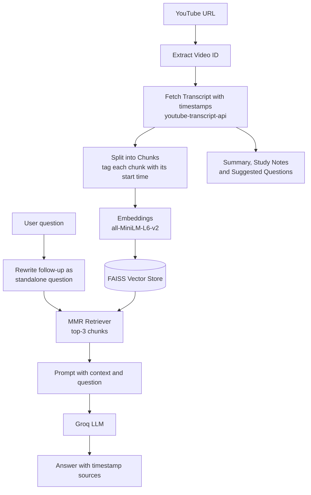

# 🎥 YouTube RAG Assistant


A Retrieval-Augmented Generation (RAG) chatbot that lets you have a conversation with any YouTube video. Paste a video URL, and the app fetches its transcript, indexes it, and answers your questions using only what was said in the video, with clickable timestamps showing where each answer came from.

**Why I built it:** learners often sit through a long video just to find one answer. This app lets them ask the question directly, check the source in the video, and get a summary and study notes without watching everything first.

Built with Streamlit, LangChain, FAISS and Groq. Tested with real users (see User Testing below).

---

## ✨ Features

| 📝 **Transcript Extraction** | 🧩 **Smart Chunking** |
|---|---|
| Fetches English captions from a YouTube video, keeping the time of every caption line. | Splits the transcript into overlapping chunks so context isn't lost at boundaries. |

| 🔍 **Semantic Retrieval** | 💬 **Grounded Q&A** |
|---|---|
| Vector embeddings + MMR search find the most relevant *and* diverse chunks. | Answers come only from the retrieved transcript. If the video doesn't say it, the bot says it doesn't know. |

| ⏱️ **Clickable Source Timestamps** | 🧠 **Conversational Memory** |
|---|---|
| Every answer shows the transcript passages it used, each linked to that exact moment in the video. | Follow-ups like "why does he say that?" are rewritten into standalone questions before retrieval. |

| 📌 **Summary, Study Notes & Suggested Questions** | ⚡ **Cached Processing** |
|---|---|
| A 5-point summary, downloadable markdown notes, and clickable starter questions are generated once per video. | A video is indexed once and reused, so asking more questions never re-processes the transcript. |

---

## 🏗️ System Architecture



---

## 🧠 How It Works

1. **URL parsing:** the video ID is extracted from standard, shortened (`youtu.be`), Shorts and embed links.
2. **Transcript fetching:** captions are fetched with the YouTube Transcript API. For every caption line, the app remembers its position in the text and its time in the video. A video without captions shows a clear error in the sidebar.
3. **Chunking:** the transcript is split into ~1000-character chunks with 200-character overlap, so an idea split across two chunks keeps its context. Each chunk is tagged with the video time where it starts.
4. **Embedding and indexing:** each chunk becomes a vector using `all-MiniLM-L6-v2` and is stored in a **FAISS** index for fast similarity search.
5. **Query rewriting (memory):** the retriever has no memory of the chat, so a follow-up such as "why?" would find nothing useful. The last few messages are used to rewrite the question into a standalone one first.
6. **Retrieval:** the **top 3** chunks are fetched with **MMR (Maximal Marginal Relevance)**, which balances relevance with diversity and avoids three near-duplicate chunks.
7. **Answer generation:** the chunks and the question go into a prompt for a Groq-hosted model, which is instructed to answer **only** from the context and to say it doesn't know when the context is insufficient.
8. **Sources:** the retrieved chunks are shown under the answer, each with a `m:ss` link that opens the video at that moment.
9. **Study material:** once per video, the app generates a summary, study notes and suggested questions from the transcript.

---

## 🛠️ Tech Stack

| Component | Technology |
|---|---|
| Web Framework | [Streamlit](https://streamlit.io/) |
| Orchestration | [LangChain](https://www.langchain.com/) (LCEL: `RunnableParallel`, `RunnablePassthrough`, `RunnableLambda`) |
| LLM | [Groq](https://groq.com/) via `langchain-groq` (model set in `.env`) |
| Embeddings | HuggingFace `all-MiniLM-L6-v2` via `langchain-huggingface` |
| Vector Store | [FAISS](https://github.com/facebookresearch/faiss) |
| Transcript Source | [`youtube-transcript-api`](https://pypi.org/project/youtube-transcript-api/) |

---

## 📂 Project Structure

```
Youtube-RAG-Chatbot/
├── YtChatbot.py        # Main application: UI, RAG pipeline, chat logic
├── requirements.txt    # Python dependencies
├── .env                # Environment variables (API keys), not committed
├── .gitignore
└── README.md           # Project documentation
```

---

## ⚙️ Setup & Installation

```bash
# 1. Clone the repository
git clone https://github.com/AditiVashisth2705/Youtube-RAG-Chatbot.git
cd Youtube-RAG-Chatbot

# 2. Create a virtual environment
python -m venv .venv
source .venv/bin/activate      # On Windows: .venv\Scripts\activate

# 3. Install dependencies
pip install -r requirements.txt
```

Create a `.env` file in the project root:

```
GROQ_API_KEY=your_groq_api_key_here
GROQ_MODEL=openai/gpt-oss-120b
```

> Get a free key at [console.groq.com](https://console.groq.com/).
> The model name lives in `.env` so it can be changed without editing code (see User Testing for why).

Run the app:

```bash
streamlit run YtChatbot.py
```

The app opens at `http://localhost:8501`.

---

## 🚀 Usage

1. Paste a YouTube video URL into the sidebar and click **Process Video**.
2. Read the summary, download the study notes, or click a suggested question.
3. Ask your own questions in the chat box. Follow-up questions work.
4. Open **Sources from the video** under an answer and click a timestamp to watch that moment.

---

## 🧑‍🤝‍🧑 User Testing

I asked **3 people** (classmates and friends) to try the app without any help from me, and noted where it failed or confused them.

**Tasks each tester was asked to do:**
1. Paste a YouTube link and get it processed.
2. Ask a question about the video, then ask a follow-up.
3. Try a video without captions and see what happens.

**Findings and fixes:**

| # | What happened | Cause | Fix |
|---|---------------|-------|-----|
| 1 | One tester could not get any answers. The app crashed with a "model not found" error when they asked a question. | The LLM model name was hardcoded, and Groq had retired that model (`llama-3.3-70b-versatile`). | Switched to `openai/gpt-oss-120b` and moved the model name into `.env` (`GROQ_MODEL`), so a future model change needs no code edit. |
| 2 | A follow-up like "why does he say that?" got the answer "I do not know". | Each question was searched on its own, so the retriever had no idea what "that" referred to. | Added conversational memory: the question is rewritten into a standalone one, using the last few messages, before retrieval. |
| 3 | A tester pasted a YouTube Shorts link (and another had a space at the end of the link) and got a "Failed to fetch transcript" error. | The video ID parser only understood `watch?v=` and `youtu.be/` links and did not trim whitespace. | The parser now trims the input and also handles `/shorts/` and `/embed/` links. |

**What I learned:** hardcoding a model name means the app breaks whenever the provider retires that model, and a retriever without chat memory fails on the most natural follow-up questions. Testing with people other than myself caught problems I would not have seen on my own machine.

---

## 🩹 Troubleshooting

- **`model_not_found` / 404 from Groq:** the model in `GROQ_MODEL` has been retired or your key cannot use it. Pick a current model from the [Groq model list](https://console.groq.com/docs/models).

---

## ⚠️ Limitations

- Needs a video with **English captions**. Videos without captions can't be processed.
- Auto-generated captions can contain mistakes, and answers are only as accurate as the captions.
- The summary, notes and suggested questions use only the first ~8,000 characters of the transcript, so for long videos they cover the beginning. Chat answers are not affected, since they search the whole transcript.

---

## 🔮 Roadmap

- [x] Source citations with clickable transcript timestamps
- [x] Conversational memory (follow-up question handling)
- [x] Auto-generated summary, study notes and suggested questions
- [ ] Quality evaluation of retrieval and answers with RAGAS
- [ ] Video title and thumbnail display
- [ ] Multi-language transcript support
- [ ] Map-reduce summarization for long videos
- [ ] Docker image and live demo on Hugging Face Spaces

---

## 👩‍💻 Author

**Aditi Vashisth**, B.Tech Computer Engineering, IIIT Bhubaneswar
[GitHub](https://github.com/AditiVashisth2705)